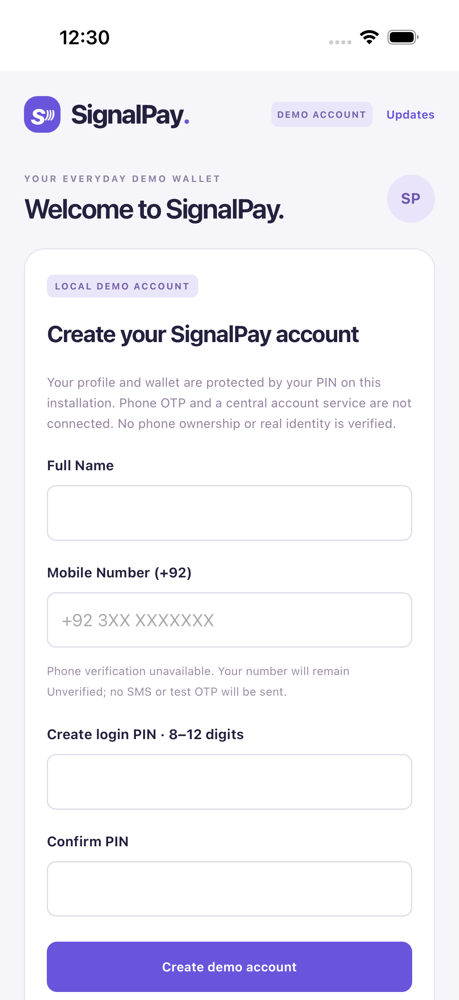

# iOS 3.4.1 bundled-file launch fix

This is an iOS-only Release wrapper patch (build 341) for the user-reported 3.4.0 real-iPhone launch failure. Physical launch of the corrected build and iPhone ↔ Android Bluetooth remain **OPEN / UNVERIFIED**. See the release's attached package-verification JSON and linked Actions run for build results.

## Verified release and download

- [Corrected unsigned IPA](https://github.com/usama-hussain-seo-spciealist/signal-app/releases/download/ios-v3.4.1/SignalPay-demo-ios-3.4.1-unsigned.ipa): **441,852 bytes**, SHA-256 `ba40026e2e0b1544ff73578c8d30c3508517b441915019223af07068d9357f1f`. Public download HTTP 200, release size/digest/checksum and extracted package verified on 27 November 2026.
- [Compiled source commit](https://github.com/usama-hussain-seo-spciealist/signal-app/commit/257ccdfbedf7181d9f978c38dbc556333f869763), [successful native build](https://github.com/usama-hussain-seo-spciealist/signal-app/actions/runs/45997932886), [shared tests](https://github.com/usama-hussain-seo-spciealist/signal-app/actions/runs/45997938284), [compatibility matrix](https://github.com/usama-hussain-seo-spciealist/signal-app/actions/runs/45997943864).
- Arm64 Mach-O executable, **iOS device platform**, minimum OS **15.0**, native version 3.4.1/build 341. No Apple provisioning profile; AltStore/Apple signing is required. This is not a simulator IPA.
- New and old public IPAs compared directly: **all 40 existing web files are byte-identical**; the only added web resource is the integrity manifest. All 40 manifest hashes, source bytes and 31 local HTML/icon references passed in simulator `.app`, device `.app` and extracted IPA. Windows verification uses canonical Git blobs to avoid checkout newline conversion.

## Measured test results

| Configuration | Clean launch/relaunch | Wallet/lifecycle tests | Resource check |
|---|---|---|---|
| iPhone 17 Pro, iOS 26.2, Xcode 16.4 | PASS, 1 test / two launches | PASS, 7 tests | PASS, 40 files |
| iPhone 17, iOS 26.5, Xcode 26.6 | PASS, 1 test / two launches | PASS, 7 tests | PASS, 40 files |
| iPhone 17 Pro Max, iOS 26.5, Xcode 26.6 | PASS, 1 test / two launches | PASS, 7 tests | PASS, 40 files |
| iPhone SE (3rd gen), iOS 18.5, Xcode 16.4 | PASS, 1 test / two launches | PASS, 7 tests after test-only harness correction | PASS, 40 files |

Other gates: **54 Node tests passed; 51 Chromium/WebKit browser tests passed, 5 skipped; 8 Swift tests passed (4 assets + 4 framing); 6 Python packaging tests passed.** Skips, desktop offline emulation and cryptographic in-memory exchanges are not physical radio proof.

Hosted wallet tests cover secure local context/native bridge, PIN/login and persistent account QR across WebView recreation, encrypted migration/non-overwrite, signed/encrypted demo transfer and duplicate receipt handling, lifecycle PIN locking, real bundled HTTP routes and origin/path guards. The black-box Release app test runs first on a fresh simulator, before injected hosted tests, and captures the account screen on both initial launch and relaunch. It is a launch test; it does not certify every touch flow or a signed physical-device upgrade.

The first compact run's app launch succeeded. Its hosted XCTest bundle then failed loading `/usr/lib/swift/libswiftWebKit.dylib`; no wallet assertion ran there. The published production executable does **not** load that dylib. A test-only Objective-C completion bridge replaces the async Swift overlay in [the harness follow-up](https://github.com/usama-hussain-seo-spciealist/signal-app/commit/bd76078). The released app code, bundle identity and IPA are unchanged. The failed run is retained and not counted as a full compatibility pass. The [corrected compact retest](https://github.com/usama-hussain-seo-spciealist/signal-app/actions/runs/46000678835) **passed all 8 tests and the 40-file resource check**, with no failures. This retest uses the follow-up test harness; production `App` and `Sources` files match the released source exactly.

Machine-readable proof: [final test results](evidence/ios-3.4.1-test-results.json), [extracted IPA checks](evidence/ios-3.4.1-ipa-check.json), [old/new package comparison](evidence/ios-3.4.1-package-comparison.json). User confirmed the corrected IPA has **not yet been installed/updated** on the physical iPhone; that gate remains pending.

## Investigation

The public 3.4.0 unsigned IPA is 420,751 bytes (about 411 KiB), SHA-256 `26681b018f7310e2cd1cecb890fcdd32e4e28c3bf7112b4d5f6ca34f1b4d133d`. Its `Payload/SignalPay.app/www/index.html` exists (22,281 bytes), together with 39 other web files. It contains a compiled native executable; no development server is needed. Small compressed size did not establish missing resources.

The exact `Missing bundled file` response originated from `BundleServer.response`. The original guard compared a standardized candidate URL against an unstandardized bundle root using a string prefix. Darwin can remove `/private` during standardization when the equivalent file exists. The prefix check could therefore reject a real file. Apple's [path standardization documentation](https://developer.apple.com/documentation/foundation/nsstring/standardizingpath) describes this behavior. A cloud Darwin regression test prints `PATH_PROBE` with the legacy decision and file-existence result; the physical failing phone's sandbox path has not been captured.

Both root and candidate are now resolved/standardized before comparing path components. Absolute paths, traversal, backslashes and symlinks escaping the root remain blocked. All wallet resources receive a generated SHA-256 manifest; startup validates the package before opening WebKit. Missing/corrupt files now produce an actionable alert rather than an unexplained blank screen.

The Darwin regression was reproduced in [the corrected source's Swift run](https://github.com/usama-hussain-seo-spciealist/signal-app/actions/runs/45997938284): `fileExists=true`, `legacyPrefixAccepted=false`, root `/private/tmp/.../www`, legacy candidate `/tmp/.../www/index.html`. The corrected reader and manifest check passed. This establishes the path-check defect; identifying the exact sandbox path on the failing physical iPhone still requires device diagnostics.

## Verification gates

- Swift tests cover `/private/tmp` alias resolution, trailing separators, inside/outside symlinks, traversal, missing/changed resources and existing Bluetooth framing.
- Python packaging tests accept a complete extracted IPA fixture and reject missing HTML, changed JavaScript, missing manifest and ZIP traversal.
- A newly created disposable iPhone Simulator runs optimized Release hosted wallet/lifecycle tests and black-box app launch/relaunch UI tests. Account-screen screenshots are exported from the actual Xcode test result.
- Simulator `.app`, arm64 iPhoneOS `.app` and the extracted final IPA must each pass manifest, required-file, local HTML/icon-reference, permission and source-byte checks.
- Shared Node/Chromium/WebKit tests must pass before publishing. None of these tests is a physical Bluetooth/radio test.

## Data compatibility

No account migration/reset is required. The shared wallet remains 3.4.0; its bundled files are compared byte-for-byte with source. Bundle ID `com.signalpay.demo.ios`, WebKit persistent store and origin `http://127.0.0.1:18743/signal-app/index.html` are unchanged. Account/PIN encryption, QR format, balances, signed history and Bluetooth protocol are unchanged. Android APK and the separately installed iPhone PWA are unaffected. Keeping the same effective signed app identity is essential for in-place data preservation; physical update preservation still needs device verification.

## Windows + AltStore Classic update

1. Keep the existing native SignalPay installed. Do not delete/deactivate it or clear its data. Keep the separately installed old demo/PWA too. Export an encrypted backup if the existing wallet is accessible.
2. Run your already configured AltServer on Windows. Connect the trusted, unlocked iPhone by USB (or the supported same-network connection). Keep Developer Mode enabled.
3. Download the **3.4.1 unsigned IPA** from this repository's `ios-v3.4.1` release to Files on the iPhone.
4. In AltStore Classic, open **My Apps → +** and choose that IPA. Use the **same Apple Account/signing identity** as the installed native SignalPay. Allow it to update the existing app. If offered removal or a separate copy instead, stop and check the identity; do not delete the original.
5. Open SignalPay. An existing native profile should show login; a fresh installation shows `Create your SignalPay account`. If you expected a native profile but see empty registration, stop and check the signing identity/backup before creating a replacement. A separate old PWA keeps its own data; moving that account to native iOS requires the existing encrypted-backup migration, not a reset of the PWA. Native version is 3.4.1/build 341; wallet UI may still show 3.4.0 because wallet code is unchanged. Check Account ID/QR/history before further payment tests.
6. If launch still fails, record iPhone model/iOS version, exact visible error and whether AltStore replaced the original app. No corrected real-device launch has yet been claimed. Refresh free-account signing before expiry through your existing AltStore setup.

Official AltStore references: [My Apps and sideloading](https://faq.altstore.io/altstore-classic/your-altstore), [Windows setup](https://faq.altstore.io/altstore-classic/how-to-install-altstore-windows), [AltServer connectivity](https://faq.altstore.io/altstore-classic/altserver).

This remains a local demo, not production banking or a production security certification. Real funds, banking connectivity and Soundbox hardware are outside this fix.

## Device compatibility scope

Minimum deployment target: **iOS 15.0**, iPhone, portrait. No model whitelist or device-specific payment path is configured. WebKit uses safe-area constraints and the existing responsive viewport/layout; encryption and CoreBluetooth use platform capabilities, not model names. iPad, macOS/Catalyst and iOS below 15 are not targets of this build.

User-provided test inventory: **iPhone 11 Pro, iOS 27.0.1, AltStore Classic working, Developer Mode enabled**. These details are reported by the user, not read remotely. Original 3.4.0 installed/failed-launch report is preserved; corrected-package installation is pending. iPhone 18 / Pro Max and all other iOS-eligible models are compatibility targets, not individually verified devices.

The independent `iPhone compatibility verification` workflow tests the exact released source commit on available compact, standard and large iPhone Simulators, using older/newer installed runtimes across standard macOS 15/26 runners. Each produces an inventory of actual Xcode/runtime/device choices, Release hosted wallet tests, clean launch/relaunch UI tests, screenshots and package integrity checks. Simulator coverage cannot certify Bluetooth radios, physical camera performance, real signing-container updates or every iOS release. iOS 15 being the build minimum does not mean an iOS 15 runtime was available or tested. Unavailable models/runtimes must remain explicitly unverified in the measured test report.

The measured runner inventories contained iOS 18.5/18.6 and 26.x, with 26.5 the newest installed runtime. **iOS 15–17, iOS 27.x, the user's iPhone 11 Pro / iOS 27.0.1 combination, and iPhone 18 / Pro Max are NOT verified by these runs.** They are not blocked by a model whitelist, but no all-model or production-readiness certification is claimed. Physical QR camera, speaker, signing/update-data retention, Bluetooth range/background behavior and both iPhone ↔ Android delivery directions remain unverified. Bluetooth transport is foreground-only; a missing or unverifiable receiver ACK must remain Pending.
